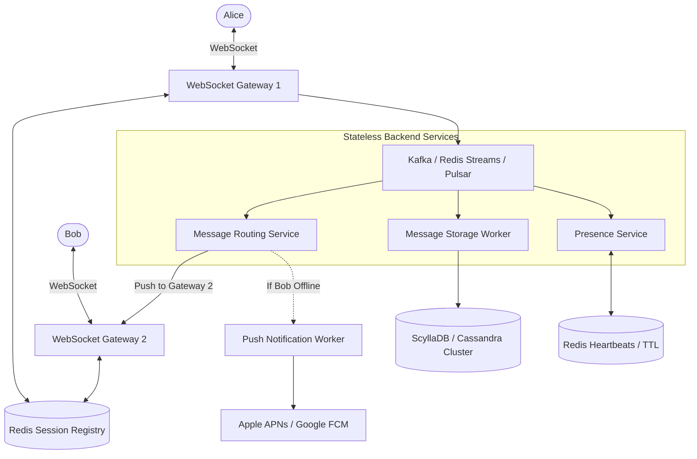
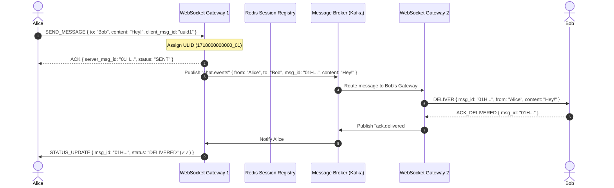

# Real-Time Chat Application: Staff-Level System Design Deep Dive

Designing a chat system (e.g., WhatsApp, Slack, Discord, WeChat) tests your mastery of **persistent stateful connections, distributed message routing, strict message ordering, fanout scaling, and high-throughput write-heavy storage.**

---

## 1. Requirements & Scope Clarification

### Functional Requirements
1. **1-on-1 Messaging**: Fast, reliable private messaging between two users.
2. **Group Chats**: Support group conversations ranging from small family groups (up to 256 members) to large channels (50,000+ members like Discord/Slack).
3. **Delivery Guarantees & Receipts**: 
   - Single check ($\checkmark$): Sent to server.
   - Double check ($\checkmark\checkmark$): Delivered to recipient's device.
   - Blue double check ($\color{blue}\checkmark\checkmark$): Read by recipient.
4. **Online Presence & Typing Indicators**: Real-time status (Online, Offline, Last Seen, "Typing...").
5. **Message History & Media**: Persistent chronological message history with media attachment support.
6. **Push Notifications**: Offline message delivery via APNs / FCM.

### Non-Functional Requirements
- **Ultra-Low Latency**: Message delivery latency **< 100ms** across continents.
- **Strict Message Ordering**: Messages within a conversation must render in the exact chronological sequence they were sent.
- **Zero Message Loss**: Messages must never be dropped, even across app crashes or network handoffs (Wi-Fi $\leftrightarrow$ 5G).
- **Massive Connection Scale**: Support 50 Million concurrently connected users.

---

## 2. Capacity Planning & Back-of-the-Envelope Math

Let us calculate scale for **50 Million Daily Active Users (DAU)**:

### A. Connection Scale & Memory
- Concurrent active connections at peak: **10 Million simultaneous WebSockets**.
- Linux TCP socket memory footprint:
  - Default OS buffer per TCP socket $\approx 4\text{ KB}$ (tuned).
  - Application session state in RAM $\approx 2\text{ KB}$.
  - Total RAM per connection $\approx 6\text{ KB}$.
- Total Memory for 10M concurrent connections:
  $$10,000,000 \times 6 \text{ KB} = \mathbf{60 \text{ GB of RAM}}$$
  *(A cluster of 15 servers with 32 GB RAM each can comfortably hold 10M live TCP connections).*

### B. Message Throughput (QPS)
- Each active user sends an average of 40 messages/day.
- Total daily messages:
  $$50,000,000 \times 40 = 2 \text{ Billion messages/day}$$
- Average Write QPS:
  $$\frac{2,000,000,000}{86,400} \approx \mathbf{23,150 \text{ msgs/sec}}$$
- Peak Write QPS ($3\times$ average) $\approx \mathbf{70,000 \text{ msgs/sec}}$.

### C. Storage Estimation (5 Years)
- Average message payload:
  - `message_id`: 16 bytes (UUID / ULID)
  - `conversation_id`: 16 bytes
  - `sender_id`: 8 bytes
  - `content`: ~150 bytes
  - `timestamp`: 8 bytes
  - `status`: 2 bytes
  - Overhead: ~40 bytes
  - Total per message $\approx \mathbf{240 \text{ bytes}}$.
- 5-Year Storage:
  $$2 \times 10^9 \text{ msgs/day} \times 365 \times 5 \times 240 \text{ bytes} \approx \mathbf{876 \text{ TB}}$$
  *(Requires an LSM-tree distributed database like ScyllaDB / Apache Cassandra, partitioned horizontally across clusters).*

---

## 3. Communication Protocol Evaluation

| Protocol | Connection Type | Latency | Bi-directional? | Verdict & Fit |
| :--- | :--- | :--- | :--- | :--- |
| **HTTP Polling** | Short-lived HTTP | High (seconds) | No (Client poll only) | **Unusable**: Wastes massive server CPU & bandwidth sending empty 304 responses. |
| **Long-Polling** | Semi-persistent HTTP | Medium (100–300ms) | No (Client pull only) | Legacy fallback when firewalls block WebSockets. |
| **Server-Sent Events (SSE)** | Persistent HTTP | Low (<50ms) | Half-duplex (Server $\rightarrow$ Client) | Good for read-only feeds (stock tickers), poor for chat because client sends must use separate HTTP POSTs. |
| **WebSockets** ⭐ *(Standard)* | Persistent full-duplex TCP | **Lowest (<10ms)** | **Full-Duplex** (Bi-directional) | **Optimal for Chat**: Minimal frame overhead (2 bytes per packet), instant bi-directional messaging. |
| **gRPC / HTTP/2 Streams** | Persistent HTTP/2 | Low (<15ms) | Full-Duplex | Excellent for internal microservice-to-microservice communication. |

---

## 4. End-to-End System Architecture



---

## 5. Message Flow: Step-by-Step

### 1-on-1 Message Routing (Alice $\rightarrow$ Bob)



---

## 6. Staff-Level Deep Dives

### A. 1-on-1 vs. Group Chat Fanout Models
How do you deliver a message sent to a group?

```
┌────────────────────────────────────────────────────────┐
│               Small Groups (< 500 members)             │
│                 "Fanout-on-Write"                      │
├────────────────────────────────────────────────────────┤
│ When Alice sends to Family Group (10 members):         │
│ The message router duplicates the message pointer into │
│ the individual inboxes of all 10 members.              │
│ - Pros: Instant delivery, fast client-side read.       │
│ - Cons: Explodes when group has 50,000 members.        │
└────────────────────────────────────────────────────────┘

┌────────────────────────────────────────────────────────┐
│               Large Groups (Discord / Slack)           │
│                 "Channel-Topic Pub/Sub"                │
├────────────────────────────────────────────────────────┤
│ The message is written ONCE to the Channel timeline.   │
│ Active channel subscribers listen to a single Pub/Sub  │
│ topic for that channel.                                │
│ - Zero message duplication in storage.                 │
└────────────────────────────────────────────────────────┘
```

### B. Message Ordering & Distributed Sequencers
How do we ensure messages appear in the exact same order on every device without clock sync bugs?
- **Do NOT use server wall clocks (`DateTime.UtcNow`) alone**: Clock drift between servers (NTP skew) will cause messages to appear out of order.
- **Solution: ULID (Universally Unique Lexicographically Sortable Identifier)** or **Snowflake ID**:
  - `48 bits`: Unix timestamp in milliseconds.
  - `80 bits`: Monotonic randomness / sequencer.
  - Lexicographically sortable: Binary/string sorting naturally matches chronological timeline order.
- **Conversation Sequence Number**: Maintain an atomic counter per conversation `(conversation_id, seq_id)` using Cassandra lightweight transactions or Redis `INCR`.

### C. Database Modeling: Why Cassandra / ScyllaDB?
Relational databases choke on $70,000\text{ writes/sec}$ and large table joins.
Cassandra/ScyllaDB uses **Log-Structured Merge-Trees (LSM-trees)**:
- Writes append sequentially to an in-memory `MemTable` and commit log with zero random disk I/O.
- Query pattern: *"Give me the last 50 messages of conversation X before timestamp T."*

#### Data Model
```sql
CREATE KEYSPACE chat_system 
WITH replication = {'class': 'NetworkTopologyStrategy', 'us-east': 3, 'eu-west': 3};

CREATE TABLE messages (
    conversation_id UUID,
    message_id TIMEUUID, -- Combines timestamp + uniqueness for automatic chronological ordering
    sender_id BIGINT,
    content TEXT,
    media_url TEXT,
    status TEXT, -- 'SENT', 'DELIVERED', 'READ'
    PRIMARY KEY ((conversation_id), message_id)
) WITH CLUSTERING ORDER BY (message_id DESC);
```
- **Partition Key**: `(conversation_id)` ensures all messages for a chat live on the same partition.
- **Clustering Key**: `message_id DESC` stores rows sequentially on disk in reverse chronological order $\rightarrow$ fetching the latest 50 messages is a single contiguous sequential disk read!

### D. Presence & Heartbeat Mechanics
How do you know if a user is online without flooding the network?
1. Client sends a **heartbeat ping every 30 seconds** over the existing WebSocket connection.
2. Presence service updates Redis with a TTL:
   ```text
   SET user:1042:presence "ONLINE" EX 45
   ```
3. If the user disconnects abruptly (battery dies, tunnel drop), the Redis key expires after 45 seconds $\rightarrow$ Status automatically switches to `OFFLINE` without requiring an explicit disconnect packet.
