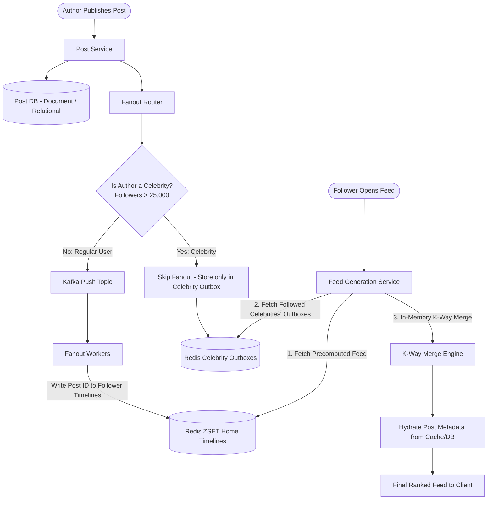

# News Feed System: Staff-Level System Design Deep Dive

A News Feed (e.g., Twitter/X Home Timeline, Instagram Feed, Facebook News Feed) is one of the most frequently asked and critical system design problems. It evaluates your understanding of **high-fanout asynchronous pipelines, cache optimization, hot-key/celebrity mitigation, and feed ranking algorithms.**

---

## 1. Requirements & Scope Clarification

### Functional Requirements
1. **Publish Post**: A user can publish a post containing text (up to 280–500 chars) and media (photos/videos).
2. **View Home Feed**: A user can view a personalized timeline containing posts from people they follow, in reverse chronological or ranked order.
3. **Follow / Unfollow**: Users can follow/unfollow other users, dynamically modifying feed sources.
4. **Pagination**: Seamless infinite scrolling without duplicate or missing items as new posts appear.

### Non-Functional Requirements
- **Ultra-Fast Feed Generation**: P99 feed generation latency **< 200ms**.
- **High Read-to-Write Ratio**: Read-heavy (~100:1 to 10:1 depending on social platform).
- **Eventual Consistency**: A new post does not need to show up on all followers' screens instantaneously; 1–5 seconds delay is completely acceptable.
- **Scale**: Support **300 Million Daily Active Users (DAU)**.

---

## 2. Capacity Planning & Scale Math

Assuming **300 Million DAU**:

### A. Traffic Estimates (QPS)
- **Active Users Reading Feed**: Each user checks their feed 5 times/day.
  $$\text{Daily Feed Reads} = 300,000,000 \times 5 = 1.5 \text{ Billion reads/day}$$
  $$\text{Read QPS} = \frac{1,500,000,000}{86,400} \approx \mathbf{17,360 \text{ reads/sec}} \quad (\text{Peak } 3\times \approx \mathbf{52,000 \text{ reads/sec}})$$
- **Active Users Posting**: Assume 20% of users publish 1 post/day.
  $$\text{Daily Posts} = 300,000,000 \times 0.20 = 60 \text{ Million posts/day}$$
  $$\text{Write QPS} = \frac{60,000,000}{86,400} \approx \mathbf{700 \text{ writes/sec}} \quad (\text{Peak } 3\times \approx \mathbf{2,100 \text{ writes/sec}})$$

### B. Fanout Multiplier (The Hidden Scaling Challenge)
- Average follower count per user = **200 followers**.
- When 700 posts/second are published:
  $$\text{Fanout Write Operations} = 700 \text{ posts/sec} \times 200 \text{ followers} = \mathbf{140,000 \text{ timeline writes/sec}}$$
- But followers are distributed via a **power-law (Pareto distribution)**:
  - Typical user: 150 followers.
  - Celebrity user: **50,000,000+ followers**.
  - A single post from a celebrity generates **50 Million writes instantly**!

### C. Cache Memory Sizing (Redis Timeline Caching)
- We do not cache the entire timeline history for every user. We only cache the **latest 800 post IDs** for **active users** (users active in last 7 days $\approx 100\text{M}$ users).
- Storing a post reference in a Redis Sorted Set (`ZSET`):
  - `member`: `post_id` (8 bytes)
  - `score`: `timestamp` (8 bytes)
  - Overhead per entry: ~16 bytes $\rightarrow \approx 32\text{ bytes}$
- Cache per user = $800 \times 32 \text{ bytes} \approx \mathbf{25.6 \text{ KB}}$.
- Total Memory for 100M active timelines:
  $$100,000,000 \times 25.6 \text{ KB} \approx \mathbf{2.56 \text{ TB of RAM}}$$
  *(Easily sharded across a Redis cluster of 16 nodes with 160 GB RAM each).*

---

## 3. The Core Architecture: Fanout Models

### Model 1: Fanout-on-Read (Pull Model)
When user Alice opens her app:
1. Fetch all people Alice follows (`SELECT followee_id FROM follows WHERE follower_id = 'alice'`).
2. Query the posts table for the latest posts of all followees.
3. Merge and sort all posts in memory by timestamp.

```
Pros:
+ Zero fanout write cost when a post is published.
+ Fast writes; zero wasted compute on inactive users who never log in.
Cons:
- Disastrous read latency: Querying 1,000 followees and merging 10,000 posts in memory on every page refresh kills DB connection pools and P99 latency (> 1,000ms).
```

### Model 2: Fanout-on-Write (Push Model)
When user Bob publishes a post:
1. Lookup all followers of Bob.
2. An asynchronous worker appends the new `post_id` into the Redis timeline cache of **every single follower**.
3. When Alice opens her app: Her timeline is **already precomputed in Redis** $\rightarrow$ single $O(1)$ query (`ZREVRANGEBYSCORE`).

```
Pros:
+ Blazing fast reads: Sub-10ms P99 feed retrieval.
Cons:
- The Celebrity / Hot-Key Problem: If an account with 80M followers posts, the background queue chokes generating 80M Redis writes.
- Wastes memory writing feeds for users who haven't opened the app in 6 months.
```

---

## 4. The Solution: Hybrid Fanout Architecture ⭐

In a Staff-level interview, you should propose the **Hybrid Fanout Model**:



### How Hybrid Fanout Solves the Edge Cases:
1. **Regular Users (< 25,000 followers)**: Use **Fanout-on-Write (Push)**. When they post, their few followers receive the update in their Redis timeline cache instantly.
2. **Celebrity Users (> 25,000 followers)**: Use **Fanout-on-Read (Pull)**. When a celebrity posts, we do **NOT** fan out to millions of followers. We store the post only in the celebrity's outbox.
3. **On Feed Read**: The user's feed service fetches their precomputed Redis timeline, fetches recent posts from any celebrities the user follows, and performs a fast, in-memory **k-way merge** of the small lists.

---

## 5. Feed Pagination: Why Cursor-Based Pagination is Mandatory

### The Flaw of Offset-Based Pagination (`OFFSET 20 LIMIT 10`):
If a user is viewing Page 1 (Posts 1–10) and 3 new posts are published while they scroll:
- Page 2 (`OFFSET 10 LIMIT 10`) shifts indices!
- The user sees **duplicate posts** they already viewed on Page 1.
- Furthermore, SQL `OFFSET 100000` is an $O(N)$ scan of all previous rows.

### Cursor-Based Pagination (Seek Method):
Use the last seen `post_id` or `timestamp` as the cursor:
```http
GET /api/feed?limit=10&cursor=01H8X9...
```
- In Redis: `ZREVRANGEBYSCORE timeline_alice (cursor_timestamp -inf LIMIT 0 10`
- In SQL: `WHERE post_id < :cursor ORDER BY post_id DESC LIMIT 10`
- **Result**: Zero duplicate items, zero skipped items, and strictly $O(\log N + K)$ performance regardless of how deep the user scrolls.

---

## 6. Feed Ranking: Chronological vs. Engagement-Ranked

Modern feeds don't just sort chronologically; they rank by relevance.


### The Scoring Function:
$$\text{Score} = w_1 \cdot P(\text{Like}) + w_2 \cdot P(\text{Comment}) + w_3 \cdot P(\text{Share}) - w_4 \cdot \text{Decay}(\Delta t)$$
- $P(\text{Action})$ is predicted using a lightweight Two-Tower Neural Network or GBDT.
- $\text{Decay}(\Delta t) = \left(\frac{\text{Age in hours} + 2}{2}\right)^{1.5}$ ensures fresh content surfaces naturally.
