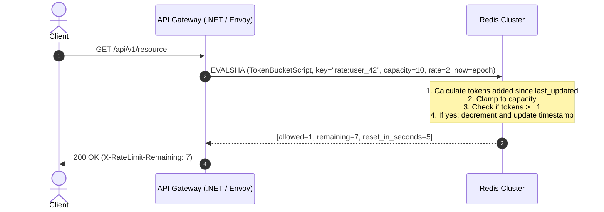

# Distributed Rate Limiter: Staff-Level System Design Deep Dive

A Rate Limiter controls the rate of traffic sent by a client or consumer to a network service. It is a critical line of defense for:
- Preventing **Denial of Service (DoS/DDoS)** attacks and resource starvation.
- Enforcing **API monetization tiers** (e.g., Free: 60 req/min, Pro: 10,000 req/min).
- Preventing **cascading failures** across downstream microservices.

---

## 1. Requirements & Scope Clarification

### Functional Requirements
1. **Accurate Throttling**: Limit requests based on defined keys (Client IP, User ID, API Key, or Route).
2. **Informative Responses**: When limit is exceeded, return `HTTP 429 Too Many Requests` with standard retry headers (`Retry-After`, `RateLimit-Remaining`, `RateLimit-Reset`).
3. **Configurable Rules**: Support dynamic tiering (e.g. `GET /search` limited to 10 req/sec; `POST /checkout` limited to 2 req/sec).

### Non-Functional Requirements
- **Ultra-Low Latency**: Rate limiting is in the critical request path. It must introduce **< 1ms overhead** (P99).
- **High Concurrency & Atomic Consistency**: In a cluster of 50 API Gateways, two simultaneous requests from the same user must not bypass the limit due to race conditions.
- **Fail-Open vs. Fail-Closed**: If the rate limiter cache (Redis) becomes unreachable, should the system block all traffic (fail-closed) or allow traffic through with logging (fail-open)? *(Standard: Fail-open with alert triggers).*
- **Minimal Memory Overhead**: Memory footprint must remain lean even with millions of concurrent active users.

---

## 2. Algorithm Comparison & Trade-Offs

| Algorithm | How it Works | Pros | Cons | Best Used For |
| :--- | :--- | :--- | :--- | :--- |
| **1. Token Bucket** ⭐ *(Industry Standard)* | Tokens added to a bucket of capacity $b$ at rate $r$. Each request consumes 1 token. | Allows short traffic bursts up to capacity $b$. Memory efficient ($O(1)$ state: `last_refill_time` + `tokens`). | Tuning parameters ($b$ and $r$) can be tricky for erratic traffic. | General API gateways (Amazon, Stripe, GitHub). |
| **2. Leaky Bucket** | Requests enter a FIFO queue of capacity $c$ and leak out at a constant fixed rate $r$. | Completely smooths out bursts into a predictable steady outflow. | Bursty traffic faces increased queue latency; drops requests if queue fills. | E-commerce checkout, message queues, database write throttles. |
| **3. Fixed Window Counter** | Divides timeline into fixed windows (e.g., 1 minute). Counter resets at window boundary. | Trivial to implement, minimum memory ($O(1)$ single integer). | **2x Boundary Burst**: 100 requests at 00:59 + 100 requests at 01:01 = 200 requests in 2 seconds! | Basic abuse prevention where precision is not critical. |
| **4. Sliding Window Log** | Keeps sorted set of timestamps for every request in Redis (`ZREMRANGEBYSCORE`). | $100\%$ accurate, zero boundary burst issues. | **Severe memory footprint**: Storing every timestamp consumes massive RAM for high-traffic APIs. | Low-volume, ultra-critical endpoints (e.g., password reset, credit card verification). |
| **5. Sliding Window Counter** ⭐ | Combines Fixed Window + weighted ratio of previous window. | Accurate ($< 0.05\%$ error), smooths boundaries, extremely memory-efficient ($O(1)$). | Assumes traffic in previous window was evenly distributed (minor approximation). | High-scale distributed gateways (Cloudflare, Akamai). |

---

## 3. The Core Concurrency Challenge: Distributed Race Conditions

When multiple API Gateway instances handle requests for the same client in parallel, a naive implementation causes race conditions:

```
Thread A: GET user:101:tokens -> returns 1
Thread B: GET user:101:tokens -> returns 1
Thread A: Decrements to 0, allows request
Thread B: Decrements to 0, allows request -> VIOLATION: 2 requests allowed when only 1 token remained!
```

### The Solution: Redis + Atomic Lua Scripting
In Redis, Lua scripts execute **atomically and single-threaded**. No other command runs while the Lua script is executing.



### Redis Token Bucket Lua Script
```lua
-- KEYS[1]: Rate limit key (e.g., "rate:user:1042")
-- ARGV[1]: Bucket capacity
-- ARGV[2]: Refill rate (tokens per second)
-- ARGV[3]: Current timestamp (Unix seconds)
-- ARGV[4]: Requested tokens (usually 1)

local key = KEYS[1]
local capacity = tonumber(ARGV[1])
local refill_rate = tonumber(ARGV[2])
local now = tonumber(ARGV[3])
local requested = tonumber(ARGV[4])

local data = redis.call('HMGET', key, 'tokens', 'last_updated')
local current_tokens = tonumber(data[1])
local last_updated = tonumber(data[2])

if current_tokens == nil then
    current_tokens = capacity
    last_updated = now
else
    local elapsed = math.max(0, now - last_updated)
    local generated_tokens = elapsed * refill_rate
    current_tokens = math.min(capacity, current_tokens + generated_tokens)
    last_updated = now
end

if current_tokens >= requested then
    current_tokens = current_tokens - requested
    redis.call('HMSET', key, 'tokens', current_tokens, 'last_updated', last_updated)
    -- Set TTL to prevent stale keys lingering in memory
    local ttl = math.ceil(capacity / refill_rate) * 2
    redis.call('EXPIRE', key, ttl)
    return { 1, math.floor(current_tokens), 0 } -- allowed = 1
else
    local needed = requested - current_tokens
    local retry_after = math.ceil(needed / refill_rate)
    return { 0, math.floor(current_tokens), retry_after } -- allowed = 0
end
```

---

## 4. Multi-Tier Distributed Rate Limiting

In enterprise architectures, rate limiting operates at multiple layers:

```mermaid
flowchart TD
    Edge[Edge / CDN - Cloudflare] -->|Tier 1: Global IP DDoS Limit (e.g. 5,000 req/sec)| LB[Load Balancer]
    LB -->|Tier 2: API Gateway Middleware| APIGateway[API Gateway Cluster]
    
    subgraph GatewayChecks["Gateway Rate Limit Checks"]
        APIGateway --> Check1["Per-User Tier (Free vs Pro)"]
        APIGateway --> Check2["Per-Route Sensitive Limits (e.g. /login: 5 req/min)"]
    end

    GatewayChecks --> Backend[Internal Microservices]
```

### Standard HTTP Response Headers (IETF Draft RFC 6585)
When returning responses:
```http
HTTP/1.1 429 Too Many Requests
Content-Type: application/json
Retry-After: 12
RateLimit-Limit: 100
RateLimit-Remaining: 0
RateLimit-Reset: 1718000012

{
    "error": "Rate limit exceeded",
    "message": "Too many requests. Please retry in 12 seconds."
}
```

---

## 5. Staff-Level Failure Modes & Resilience Patterns

1. **Redis Network Latency Mitigation (Local Token Cache)**:
   - Calling Redis over the network on every single HTTP packet adds 1–2ms.
   - For ultra-high QPS (>500,000 req/sec), use **Local Memory Batched Token Allocation**:
     - The gateway instance leases a batch of 50 tokens from Redis at once.
     - It decrements locally in memory via `Interlocked.Decrement`.
     - Only when local tokens hit 0 does it request the next batch from Redis.
2. **Fail-Open Strategy**:
   - If Redis undergoes a failover or network partition, the rate limiter enters a **circuit-broken fail-open state**.
   - Requests are allowed through with a telemetry alert rather than shutting down the entire platform for paying customers.
3. **Clock Skew Defense**:
   - In distributed clusters, server clocks drift by milliseconds.
   - Solution: Use the **Redis server time** (`redis.call('TIME')`) inside the Lua script instead of relying on client machine timestamps.
