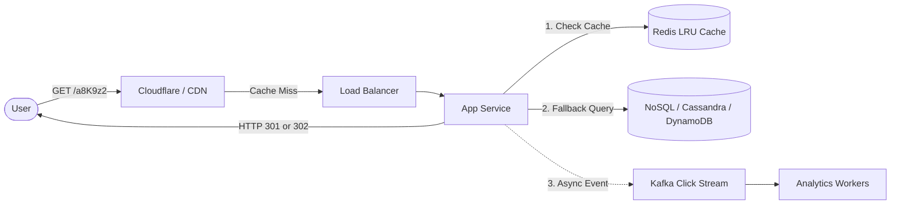
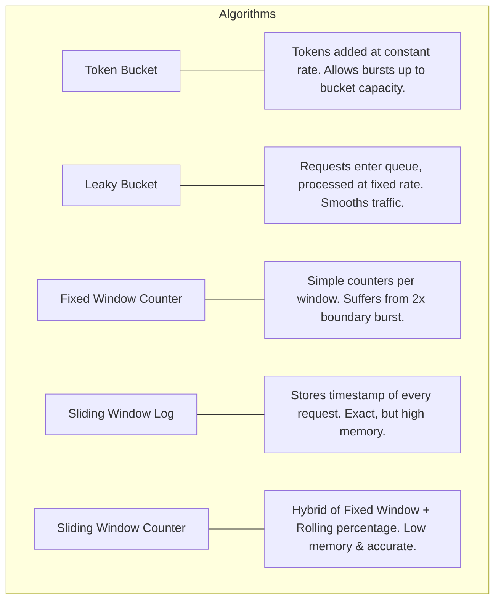
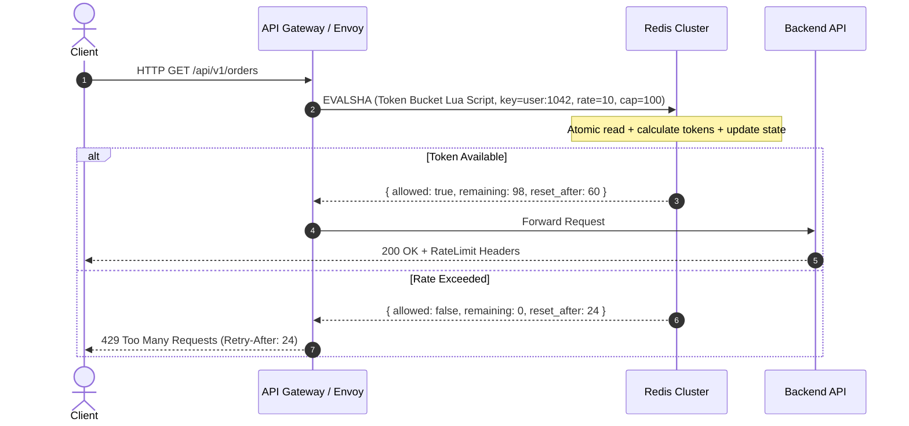
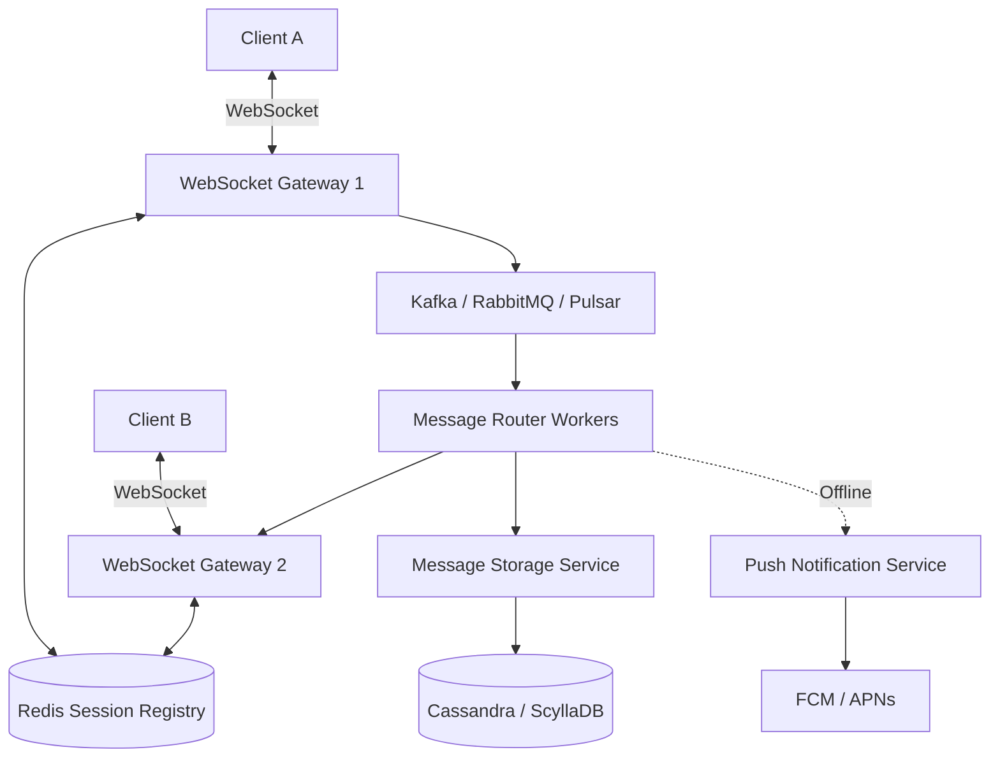
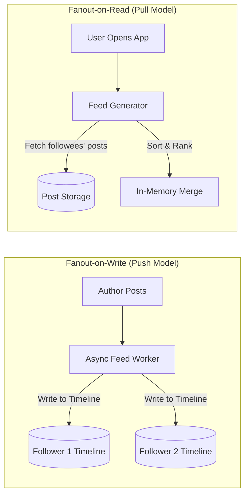
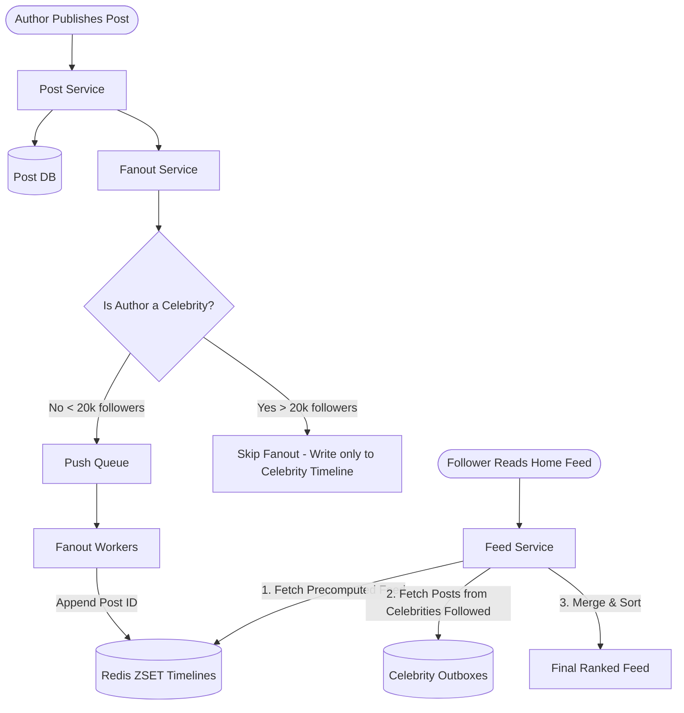
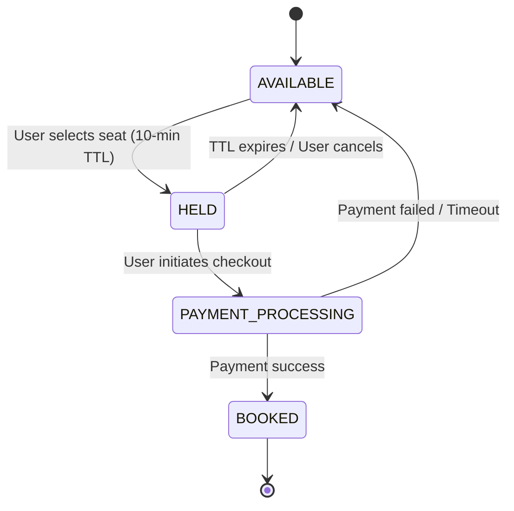
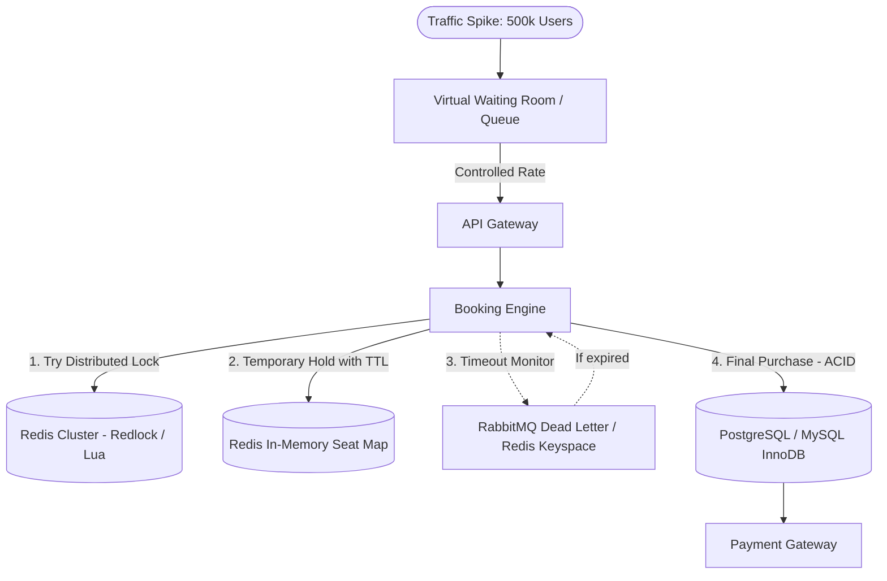

# System Design Mastery: The 5 Foundational Projects

These 5 projects represent the archetypes of modern distributed systems. Mastering them equips you with 90%+ of the patterns, trade-offs, and failure modes evaluated in Senior and Staff-level system design.

---

## The Pattern Matrix

Before diving into each system, see how these 5 systems map directly to core distributed systems challenges:

| System | Primary Archetype | Core Architectural Challenge | Key Technologies |
| :--- | :--- | :--- | :--- |
| **1. URL Shortener** | Read-Heavy Key-Value Store | ID generation, hashing collisions, caching, redirect semantics | Base62, Redis LRU, Cassandra/DynamoDB, KGS |
| **2. Rate Limiter** | Low-Latency Distributed Middleware | Concurrency, race conditions, atomic operations, algorithms | Token/Leaky Bucket, Redis + Lua scripts, Sliding Window |
| **3. Chat Application** | Real-Time Bi-Directional Messaging | Persistent connections, message routing, ordering, presence | WebSockets, Kafka/Pulsar, ScyllaDB/Cassandra |
| **4. News Feed** | High-Fanout Feed Generation | Fanout-on-write vs Fanout-on-read, ranking, cache invalidation | Redis Sorted Sets, Hybrid Fanout, Cursor Pagination |
| **5. Ticket Booking** | High-Contention Transactional System | Distributed locking, race conditions, seat reservation state | Redis Redlock, Pessimistic/Optimistic locking, RDBMS ACID, Virtual Waiting Room |

---

## 1. URL Shortener (e.g., TinyURL / Bitly)

### Problem Statement
Convert a long URL (e.g. 500 characters) into a short, unique URL (e.g. `https://sho.rt/a8K9z2`) and redirect visitors with sub-10ms latency.

### Key Requirements
- **Functional**: Shorten long URL, redirect short URL to original destination, custom aliases, URL expiration, click analytics.
- **Non-Functional**: High availability (99.99%), low latency redirection (<10ms), read-heavy (100:1 read-to-write ratio), unguessable URLs.

### Architectural Decisions & Trade-offs
```
┌────────────────────────────────────────────────────────┐
│                   ID Generation Choices                 │
├────────────────────────────────────────────────────────┤
│ 1. Hash (MD5/SHA256) + Base62:                         │
│    - Fast, but collisions require DB probing.          │
│ 2. Auto-increment Counter:                             │
│    - Easy, but single point of failure and guessable.   │
│ 3. Key Generation Service (KGS) / Pre-generated keys:  │
│    - Best: Standalone service pre-generates 7-char IDs │
│      and stores them in two tables: "used" and "free". │
│ 4. Distributed Snowflake ID Generator:                 │
│    - 64-bit integer (timestamp + worker ID + sequence)  │
│      converted to Base62.                              │
└────────────────────────────────────────────────────────┘
```



### Senior / Staff-Level Insights
1. **HTTP 301 vs. 302 Redirect**:
   - `301 Permanent Redirect`: Browser caches the redirect; subsequent requests never hit your server. **Great for server load, terrible for analytics tracking**.
   - `302 Found / 307 Temporary Redirect`: Every click routes through your server. **Essential when tracking click metrics, referral headers, and geolocation**.
2. **Key Generation Service (KGS)**:
   - Pre-generate 7-character Base62 keys in advance ($62^7 \approx 3.5 \text{ trillion}$ unique keys).
   - Load batches of unused keys into memory on app server start. If an app instance dies, orphaned keys are abandoned (acceptable loss with 3.5T keys).
3. **Storage Engine Choice**:
   - No complex relationships. Queries are simple key-value lookups (`short_key -> original_url`).
   - A distributed NoSQL key-value store (DynamoDB or Cassandra) scales horizontally with zero join overhead compared to a relational database.

---

## 2. Distributed Rate Limiter

### Problem Statement
Protect backend services from DDoS attacks, brute force, resource exhaustion, and enforce API monetization tiers.

### Key Requirements
- **Functional**: Limit requests per client (IP, user ID, API key) per time window (e.g. 100 req/min). Return `429 Too Many Requests`.
- **Non-Functional**: Extremely low latency (< 1ms overhead), minimal memory footprint, distributed synchronization across multi-region clusters.

### Algorithm Comparison


### Distributed Architecture & Concurrency Control
In a multi-node deployment, race conditions occur when two requests for the same client hit different API gateway nodes simultaneously.



### Senior / Staff-Level Insights
1. **Atomicity via Redis Lua Scripts**: Never do a separate `GET` then `INCR` or `SET` in application code (classic race condition). Combine calculation and storage in an atomic Redis Lua script or use Redis Cell module.
2. **Local Memory Caching + Batch Sync**:
   - Querying Redis over the network on every single HTTP packet adds 1–2ms.
   - High-throughput setups use local in-memory counters (e.g. Envoy local rate limiting) with periodic asynchronous batch sync to Redis.
3. **Response Headers**:
   Always surface standard IETF headers:
   - `X-RateLimit-Limit`: Maximum requests allowed in current window.
   - `X-RateLimit-Remaining`: Remaining allowance.
   - `X-RateLimit-Reset`: Unix epoch timestamp when window resets.
   - `Retry-After`: Seconds to wait before retrying (on 429).

---

## 3. Real-Time Chat Application (e.g., WhatsApp / Slack / Discord)

### Problem Statement
Enable real-time 1-on-1 and group messaging with presence tracking (online/offline/typing) and message history.

### Key Requirements
- **Functional**: 1-on-1 chat, group chat (up to thousands of members), online presence, message status (Sent, Delivered, Read), push notifications for offline users.
- **Non-Functional**: Real-time delivery (<100ms), reliable delivery (no lost messages), message ordering, horizontal scalability.

### Architecture Overview


### Senior / Staff-Level Insights
1. **Connection Layer Separation**:
   - WebSocket connections are stateful and long-lived. Keep WebSocket Gateways lightweight: they only maintain TCP sockets and route bytes.
   - Business logic, authentication, and persistence live in stateless backend microservices behind a message queue.
2. **Session Registry**:
   - Store `UserID -> WebSocket_Gateway_ID` in an in-memory cluster (e.g. Redis).
   - When User A sends a message to User B: lookup User B's server node, push to that node's queue, and emit down User B's socket.
3. **Group Chat Fanout (Small vs. Large Groups)**:
   - **Small groups (WhatsApp family group, < 100 members)**: Fanout-on-write. Copy the message pointer to each recipient's inbox.
   - **Large channels (Discord / Slack 50,000+ members)**: Do NOT fan out per user. Store one message in the channel timeline; clients poll/subscribe to the channel topic.
4. **Storage Engine**:
   - Chat messages are append-heavy and queried chronologically (`WHERE conversation_id = ? ORDER BY timestamp DESC LIMIT 50`).
   - Relational DBs degrade under high write volume. Use wide-column stores like **Cassandra** or **ScyllaDB** with partition key `conversation_id` and clustering key `message_id` (Snowflake ID or ULID for chronological sort).

---

## 4. News Feed System (e.g., Twitter / Instagram Timeline)

### Problem Statement
Generate personalized feeds of content created by friends/connections in reverse chronological or ranked order.

### Key Requirements
- **Functional**: Publish posts, follow/unfollow users, view aggregated home timeline, support photos/videos.
- **Non-Functional**: Fast feed loading (<200ms), handle viral spikes (celebrities with 50M+ followers), eventual consistency.

### Fanout-on-Write vs. Fanout-on-Read


### The Hybrid Fanout Architecture


### Senior / Staff-Level Insights
1. **The Celebrity Problem**:
   - If an account with 80 million followers posts, Fanout-on-write requires 80 million writes to Redis. This causes hot partitions, queue congestion, and lag.
   - Solution: **Hybrid approach**. Regular users use Push (precomputed feeds in Redis `ZSET`). Celebrities use Pull. On feed read, merge the user's precomputed feed with posts from celebrities they follow.
2. **Timeline Cache Structure**:
   - Use Redis Sorted Sets (`ZSET`). The `member` is the `post_id`, and the `score` is the `timestamp` or `ranking_score`.
   - Store only the last 500–1000 post IDs per active user. Trim older IDs (`ZREMRANGEBYRANK`) to control memory costs. Fetch full post content (text, author, media URLs) in a batch query.
3. **Cursor-Based Pagination**:
   - Never use `OFFSET` and `LIMIT` (SQL `OFFSET 1000` is slow and causes duplicate/missing items when new posts arrive).
   - Use cursor pagination: `GET /feed?cursor=post_id_10482&limit=20`.

---

## 5. High-Concurrency Ticket Booking System (e.g., Ticketmaster / BookMyShow)

### Problem Statement
Sell out a 50,000-seat stadium in 2 minutes without double-booking, while handling payment gateway latency and inventory holding.

### Key Requirements
- **Functional**: View venue seat map, select specific seats, temporarily hold seats during checkout (e.g., 10 minutes), complete payment, issue tickets.
- **Non-Functional**: Zero double-booking (strict consistency), high availability during traffic surges, fault-tolerant reservation timeouts.

### Reservation State Machine


### High-Throughput Architecture


### Senior / Staff-Level Insights
1. **The 3 Concurrency Gates**:
   - **Gate 1: Virtual Waiting Room (Traffic Throttling)**: Use Cloudflare Waiting Room or a Kafka-backed token bucket queue at the edge to only admit the number of users the backend can service.
   - **Gate 2: In-Memory Distributed Lock (Redis)**: Check and hold seat status atomically in Redis via Lua scripts:
     ```lua
     -- Atomic check & hold
     if redis.call('GET', KEYS[1]) == 'AVAILABLE' then
         redis.call('SET', KEYS[1], ARGV[1], 'EX', 600) -- hold for 600s
         return 1
     else
         return 0
     end
     ```
   - **Gate 3: Relational DB with Row-Level Locks**: For the actual financial transaction, write to PostgreSQL/MySQL with strict ACID guarantees.
2. **Handling Reservation Expiry**:
   - Do not poll the database every second for expired seats (`SELECT * WHERE status = 'HELD' AND expires_at < NOW()`).
   - Use **delayed message queues** (RabbitMQ delayed exchange, SQS delayed message, or Redis sorted sets sorted by expiration epoch). When the message matures at $t+10\text{min}$, a worker checks if payment completed; if not, seat is flipped back to `AVAILABLE`.
3. **Idempotency Keys**:
   - Prevent duplicate charges if the user taps "Pay" twice or a network retry occurs.
   - Generate a unique `Idempotency-Key` (UUID) per checkout session. Store it in Redis with an atomic lock while payment processes.

---

## The Cross-System Cheat Sheet

| Concern | URL Shortener | Rate Limiter | Chat App | News Feed | Ticket Booking |
| :--- | :--- | :--- | :--- | :--- | :--- |
| **Consistency vs Availability** | High Availability (AP) | High Availability / Low Latency (AP) | Tunable / Eventual (AP for delivery, CP for ordering) | Eventual Consistency (AP) | **Strict Consistency (CP)** |
| **DB Paradigm** | Key-Value NoSQL | In-Memory (Redis) | Wide-Column (Cassandra) | In-Memory ZSET + Document DB | **Relational ACID (Postgres/MySQL)** |
| **Caching Layer** | Redis LRU for hot URLs | In-memory local cache + Redis | Redis session registry | Redis Sorted Sets for timelines | Redis for transient seat state |
| **Primary Protocol** | HTTP REST | HTTP / gRPC middleware | **WebSockets / TCP** | HTTP REST / GraphQL | HTTP REST + Idempotent POST |

---

## Hands-On Practice Checklist

To internalize these concepts, build these minimal prototypes in code:
- [ ] **Base62 Converter + Collision Handler**: Write a standalone service in your favorite language that encodes 64-bit integers to Base62.
- [ ] **Redis Lua Token Bucket**: Write a Python/Go script that connects to Redis and implements an atomic token bucket rate limiter with `EVAL`.
- [ ] **WebSocket Gateway**: Build a multi-room chat server using WebSockets and Redis Pub/Sub for cross-node message routing.
- [ ] **Timeline Generator**: Build a feed engine using Redis Sorted Sets to simulate fanout-on-write and fanout-on-read for 10,000 mock users.
- [ ] **Optimistic vs Pessimistic Booking Simulation**: Simulate 100 concurrent threads trying to book the same 5 database rows using `SELECT FOR UPDATE` vs version-number checks.
