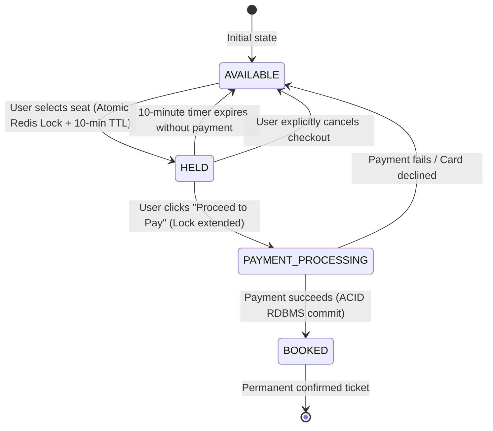

# High-Concurrency Ticket Booking System: Staff-Level System Design Deep Dive

A Ticket Booking System (e.g., Ticketmaster, BookMyShow, StubHub, IRCTC) is the ultimate test of **high-concurrency transactional consistency, race condition prevention, distributed locking, and graceful traffic absorption.**

When tickets for a mega-concert (like Taylor Swift or Coldplay) go live, **500,000+ users compete for 50,000 seats within seconds.** A single double-booked seat leads to legal liability and PR catastrophe.

---

## 1. Requirements & Scope Clarification

### Functional Requirements
1. **View Venue & Seat Map**: Real-time visualization of venue seating layouts and availability (Available, Held, Booked).
2. **Temporary Seat Hold (Reservation)**: When a user selects seats, hold them for **10 minutes** to allow payment completion.
3. **Release on Expiry**: If payment is not completed within 10 minutes, automatically release the seats back to `AVAILABLE`.
4. **Checkout & Payment**: Confirm booking upon successful payment and generate digital tickets.
5. **Zero Double-Booking**: Strictly **impossible** for two users to hold or book the same seat.

### Non-Functional Requirements
- **Strict Consistency (ACID / CP)**: In the CAP theorem, this system is strictly **CP**. Availability must be sacrificed before allowing inconsistent double bookings.
- **High Concurrency & Flash-Sale Absorption**: Handle 100,000+ requests/second during flash sales without database connection exhaustion.
- **Low Latency**: Seat map rendering < 100ms; hold reservation < 50ms.
- **Idempotency**: Retrying a payment or booking request must never result in duplicate charges or duplicate seats.

---

## 2. Capacity Planning & Scale Math

Consider a stadium concert with **50,000 seats** and **500,000 concurrent buyers**:

### A. Traffic Estimates (Flash Sale Spike)
- Total buyers: 500,000.
- Peak Click QPS on "Book Seat":
  $$\text{Peak Write QPS} = \mathbf{50,000 \text{ to } 100,000 \text{ req/sec}}$$
- Direct database writes at 50,000 QPS will instantly crash PostgreSQL/MySQL due to row-lock contention.

### B. Storage Estimates
- 1 Event = 50,000 seats.
- Seat record size:
  - `seat_id`: 8 bytes
  - `event_id`: 8 bytes
  - `row`: 4 bytes
  - `number`: 4 bytes
  - `status`: 2 bytes (`AVAILABLE`, `HELD`, `BOOKED`)
  - `user_id`: 8 bytes
  - `held_until`: 8 bytes
  - Total per seat $\approx \mathbf{64 \text{ bytes}}$.
- Entire 50,000-seat stadium map in RAM:
  $$50,000 \times 64 \text{ bytes} \approx \mathbf{3.2 \text{ MB}}$$
  *(The entire seat state for a stadium fits in 3.2 MB of Redis RAM!)*

---

## 3. The 3 Concurrency Gates Architecture

To survive flash sales, we place **3 Concurrency Gates** between the user and the relational database:

```mermaid
flowchart TD
    Buyers([500,000 Concurrent Buyers]) --> Edge[Gate 1: Virtual Waiting Room<br/>Cloudflare / Leaky Bucket Queue]
    Edge -->|Admit 5,000 buyers/sec| APIGateway[API Gateway Cluster]

    subgraph MemoryTier["Gate 2: In-Memory Distributed Lock"]
        APIGateway --> Redis[(Redis In-Memory Seat Cache & Distributed Lock)]
        Redis -->|Atomic Lua Check & Hold| LockCheck{Is Seat Available?}
    end

    LockCheck -->|No: Seat Taken| Reject[Immediate 409 Conflict<br/>Latency: 2ms | 0 DB Load]
    LockCheck -->|Yes: Hold Granted for 10 Mins| Token[Issue 10-Min Reservation Token]

    Token --> DelayQueue[Delayed Message Queue<br/>RabbitMQ Dead Letter / Redis TTL]
    DelayQueue -.->|10 Mins Later: Check Payment| Reconciler[Seat Releaser Worker]

    Token --> Checkout[Checkout & Payment Service]
    Checkout --> PG[Payment Gateway - Stripe/PayPal]

    subgraph DBTier["Gate 3: Relational DB ACID Transaction"]
        PG -->|Payment Success| RDBMS[(PostgreSQL / MySQL InnoDB)]
        RDBMS --> FinalTicket[Issue Confirmed Ticket]
    end
```

---

## 4. The Seat Reservation State Machine



---

## 5. Staff-Level Deep Dives

### A. How Distributed Locking Works in Redis (Atomic Lua Script)
Never do `GET seat_101` followed by `SET seat_101`. Two threads will both read `AVAILABLE` and overwrite each other (classic double booking).
Use an **atomic Redis Lua script**:

```lua
-- KEYS[1]: seat_key (e.g. "seat:event_99:A_12")
-- ARGV[1]: user_id
-- ARGV[2]: hold_duration_seconds (600)

local current_status = redis.call('GET', KEYS[1])

if current_status == nil or current_status == 'AVAILABLE' then
    redis.call('SET', KEYS[1], 'HELD:' .. ARGV[1], 'EX', tonumber(ARGV[2]))
    return 1 -- Hold acquired successfully
else
    return 0 -- Seat already held or booked
end
```

### B. Optimistic vs. Pessimistic Locking in the Database

| Locking Strategy | How It Works | Performance under High Contention | Verdict |
| :--- | :--- | :--- | :--- |
| **Pessimistic Locking** (`SELECT FOR UPDATE`) | Locks the database row until the transaction commits. Other threads wait in queue. | **High lock waiting time, connection pool exhaustion**, potential deadlocks. | Bad for flash sales; acceptable for low-volume corporate bookings. |
| **Optimistic Locking** (`version` column) | No lock. Reads version $V_1$. On update: `UPDATE seats SET status='HELD', version=2 WHERE id=10 AND version=1`. | If 100 users try simultaneously, 1 succeeds, 99 fail instantly with zero lock waiting. | **Best for RDBMS layer.** |
| **Redis In-Memory Guard (Recommended)** ⭐ | Filter 99.9% of traffic in Redis before ever touching the database. | Zero DB lock contention. $O(1)$ sub-millisecond execution. | **The Industry Standard.** |

### C. Automatic Expiration Without Polling
How do you release seats when 10 minutes expire?
- **Anti-Pattern**: Running `SELECT * FROM seats WHERE status = 'HELD' AND held_until < NOW()` every second. This causes continuous heavy database table scans.
- **Best Practice (Delayed Queues)**:
  - When seat is held at $T$, publish a delayed message to RabbitMQ with a 10-minute TTL.
  - When the message arrives at $T+10\text{min}$, a worker checks if the seat has moved to `BOOKED`.
  - If still `HELD`, the worker sets it back to `AVAILABLE` and publishes a WebSocket event to update clients' seat maps in real time!

### D. Idempotency Keys
Network drops between the payment gateway and your server can cause a user to tap "Pay" twice.
- Client generates a UUID `Idempotency-Key: e82b...` on checkout initiation.
- The server checks Redis `SETNX idempotency:e82b... "IN_PROGRESS" EX 120`.
- If key already exists, subsequent clicks are deduplicated.
