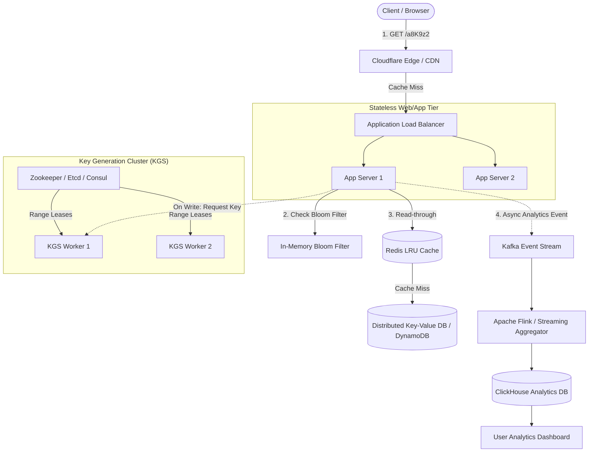
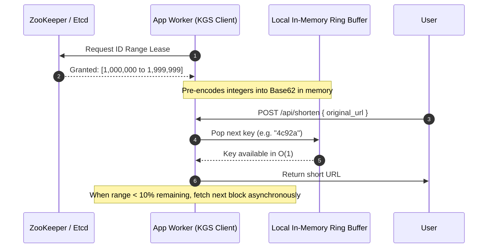

# URL Shortener: Staff-Level System Design Deep Dive

A URL Shortener (e.g., TinyURL, Bitly) appears deceptively simple at first glance, but at hyperscale it exposes the fundamental challenges of distributed systems: **ID generation without single points of failure, read-heavy caching, cache penetration, and low-latency analytics ingestion.**

---

## 1. Requirements & Scope Clarification

### Functional Requirements
1. **Shorten URL**: Given a long URL (e.g., up to 2048 characters), generate a short, unique alias (e.g., `https://sho.rt/a8K9z2`).
2. **Redirection**: Given a short alias, redirect the user to the original long URL with sub-10ms latency.
3. **Custom Aliases**: Users can optionally pick custom aliases (e.g., `https://sho.rt/my-portfolio`).
4. **Expiration / TTL**: URLs can have an optional expiration date, after which they are deactivated.
5. **Analytics**: Track click count, referrers, browser/device types, and geolocation for each shortened link.

### Non-Functional Requirements
- **High Availability**: Redirection must be 99.99% available. If an analytics worker is down, redirects must still work uninterrupted.
- **Ultra-Low Latency**: Redirection lookup must take **< 10ms** (P99).
- **Read-Heavy Workload**: 100:1 read-to-write ratio.
- **Security & Predictability**: Short links must not be easily guessable/sequential (to prevent scraping and enumeration attacks).

---

## 2. Capacity Estimation & Back-of-the-Envelope Math

Let us calculate capacity assuming **100 Million new URLs created per month**.

### A. Traffic Estimates (QPS)
- **Write QPS**:
  $$\text{New URLs per second} = \frac{100,000,000}{30 \times 24 \times 3600} \approx 40 \text{ writes/sec}$$
  - Peak Write QPS ($2\times$ average) $\approx \mathbf{80 \text{ writes/sec}}$
- **Read QPS** (at 100:1 read-to-write ratio):
  $$\text{Redirects per second} = 40 \times 100 = \mathbf{4,000 \text{ reads/sec}}$$
  - Peak Read QPS ($3\times$ average) $\approx \mathbf{12,000 \text{ reads/sec}}$

### B. Storage Estimates (5-Year Horizon)
- Total URLs in 5 years:
  $$100,000,000 \times 12 \times 5 = 6 \text{ billion URLs}$$
- Record size estimate:
  - `short_key`: 7 bytes (VARCHAR(7))
  - `original_url`: ~500 bytes (average)
  - `user_id`: 8 bytes (BIGINT / UUID)
  - `created_at`: 8 bytes (TIMESTAMP)
  - `expires_at`: 8 bytes (TIMESTAMP)
  - Metadata / overhead: ~30 bytes
  - **Total per record**: $\approx \mathbf{560 \text{ bytes}}$
- Total 5-year storage:
  $$6,000,000,000 \times 560 \text{ bytes} \approx \mathbf{3.36 \text{ TB}}$$
  *(3.36 TB easily fits into modern distributed storage or even a sharded relational cluster).*

### C. Cache Memory Estimates (80/20 Rule)
- 20% of the URLs generate 80% of daily read traffic.
- Daily read count:
  $$4,000 \times 86,400 \approx 345 \text{ million reads/day}$$
- Daily unique hot URLs to cache (20% of daily traffic):
  $$0.20 \times 345,000,000 = 69 \text{ million URLs}$$
- Memory required for caching hot URLs:
  $$69,000,000 \times 560 \text{ bytes} \approx \mathbf{38.6 \text{ GB}}$$
  *(38.6 GB easily fits into a single Redis cluster node with replication).*

---

## 3. High-Level Architecture



---

## 4. Deep-Dive: Short Key Generation Strategies

How do we create a compact 7-character string using characters `[0-9a-zA-Z]` (Base62)?
With 62 characters:
$$62^7 = 3,521,614,606,208 \approx \mathbf{3.5 \text{ Trillion unique URLs}}$$
Even at 100M URLs/month, 3.5 trillion URLs will last over **2,900 years**.

### Comparison of Generation Approaches

| Approach | How it works | Pros | Cons / Failure Modes |
| :--- | :--- | :--- | :--- |
| **1. Hash of URL (MD5/SHA256) + Base62** | Hash long URL, take first 7 chars. | Stateless, deterministic. | **Collisions guaranteed** (Birthday Paradox). Requires querying DB to check collisions and appending salt. |
| **2. DB Auto-Increment ID** | Convert numeric ID to Base62. | Zero collisions, compact. | Single Point of Failure (SPOF) on master DB, predictable/guessable URLs. |
| **3. Distributed Snowflake ID** | 64-bit int (Epoch + Node ID + Sequence). | Highly available, no centralized coordinator. | IDs are 64 bits $\rightarrow$ Base62 is 11 chars (longer short URL). |
| **4. Range-Based Key Generation Service (KGS)** ⭐ *(Recommended)* | Central coordinator (Etcd/ZooKeeper) leases blocks of 1,000,000 integers to workers. Workers encode integers into Base62. | **Zero collisions**, $O(1)$ memory lookup, zero lock contention during writes, short 7-char URLs. | If a worker crashes, its unused allocated block of IDs is lost (negligible given 3.5T capacity). |



---

## 5. HTTP Redirection Semantics: 301 vs. 302 vs. 307

| Code | Meaning | Browser Behavior | Impact on Analytics | Recommendation |
| :--- | :--- | :--- | :--- | :--- |
| **301 Moved Permanently** | Target URL has permanently moved. | **Cached in browser cache**. Subsequent clicks never hit our server. | **Severe**: Cannot count clicks, identify referrers, or update expired links. | Use only if you strictly want to minimize server load and do not care about analytics. |
| **302 Found** | Temporary redirect. | Not cached permanently. Every click hits our server. | Accurate analytics tracking. | Historically common, but some HTTP clients erroneously convert `POST` to `GET`. |
| **307 Temporary Redirect** ⭐ | Temporary redirect preserving HTTP method. | Not cached by default. Every request hits server. | **Best**: Complete click analytics, referral header inspection, geo tracking. | **Recommended standard for URL Shorteners.** |

---

## 6. Advanced Edge Cases & Defenses

### A. Preventing Cache Penetration (Bloom Filters)
- **The Attack**: Malicious bots send millions of requests for non-existent short keys (`/fake123`, `/bogus999`).
- **The Problem**: Cache misses hit the database on every request, exhausting DB connection pools.
- **The Solution**: An in-memory **Bloom Filter** at the API Gateway or App server.
  - If Bloom Filter returns `false` $\rightarrow$ Key **definitely does not exist**; return `404 Not Found` immediately without touching Redis or DB.
  - If Bloom Filter returns `true` $\rightarrow$ Key **likely exists**; proceed to Cache $\rightarrow$ DB.

```mermaid
flowchart LR
    Request([GET /nonExistent123]) --> Filter{Bloom Filter}
    Filter -->|False: Definitely Not In DB| Direct404[404 Not Found (0ms DB load)]
    Filter -->|True: Probably In DB| Cache[(Redis Cache)]
    Cache -->|Miss| DB[(Database)]
```

### B. Cache Stampede (Thundering Herd)
- If a viral link expires from Redis, 10,000 concurrent requests simultaneously miss the cache and overwhelm the database.
- **Defense**: Use **Single-Flight (Request Coalescing)** or a distributed mutex (`SETNX`). Only one worker fetches the URL from DB and repopulates the cache; all other 9,999 requests wait for the result.

### C. URL Expiration & Cleanup
- Rather than running heavy `DELETE WHERE expires_at < NOW()` table scans:
  1. **Passive Deletion**: When a user visits an expired link, check `expires_at > NOW()`. If expired, return `410 Gone` and enqueue background deletion.
  2. **Active Sweeping**: A scheduled low-priority cron job cleans up expired records during off-peak hours using indexed range scans.

---

## 7. Data Models & Schemas

### Relational Schema (PostgreSQL / MySQL)
```sql
CREATE TABLE urls (
    id BIGINT PRIMARY KEY,
    short_code VARCHAR(10) UNIQUE NOT NULL,
    original_url TEXT NOT NULL,
    user_id BIGINT NULL,
    created_at TIMESTAMP WITH TIME ZONE DEFAULT CURRENT_TIMESTAMP,
    expires_at TIMESTAMP WITH TIME ZONE NULL,
    is_active BOOLEAN DEFAULT TRUE
);

CREATE INDEX idx_urls_short_code ON urls(short_code);
CREATE INDEX idx_urls_expires_at ON urls(expires_at) WHERE is_active = TRUE;
```

### NoSQL Schema (DynamoDB / Cassandra)
- **Table**: `urls`
- **Partition Key (PK)**: `short_code` (String)
- **Attributes**:
  - `original_url`: String
  - `user_id`: String
  - `created_at`: Number (Unix epoch)
  - `expires_at`: Number (Unix epoch)
  - `ttl`: Number (Native DynamoDB TTL attribute for automatic eviction)

---

## 8. Mock Interview Drill (Staff-Level Q&A)

### Q1: "What if two users request to shorten the exact same long URL? Should they get the same short URL or different ones?"
- **Answer**: 
  - In a commercial shortener (like Bitly), **give them different short URLs**.
  - *Reasoning*: Each user needs independent ownership for custom aliases, privacy, deletion rights, and unique analytics (e.g., User A running an ad campaign vs User B sharing with a friend).
  - *Deduplication exception*: If storage cost is the primary constraint, a single global mapping with a join table `(user_id, short_code)` can be used, but this adds complexity to analytics partitioning.

### Q2: "How do you protect the service from phishing, malware, and spam?"
- **Answer**:
  - **Synchronous**: Run domain checks against Google Safe Browsing API or Spamhaus on the write path (`POST /shorten`). Reject malicious domains.
  - **Asynchronous**: Periodic crawlers re-inspect destination landing pages for post-creation defacement or cloaking.
  - **Rate Limiting**: Tiered rate limits by IP and API key to prevent mass link generation.

### Q3: "How do you handle multi-region replication and data consistency?"
- **Answer**:
  - URL shorteners are **read-heavy (100:1) and append-only**.
  - We can run Multi-Region Active-Active with read replicas in every region (US-East, US-West, EU, APAC).
  - Writes are routed to the nearest regional database or global DynamoDB with global tables. Eventual consistency of 50–200ms across regions is completely acceptable for URL shortening.
